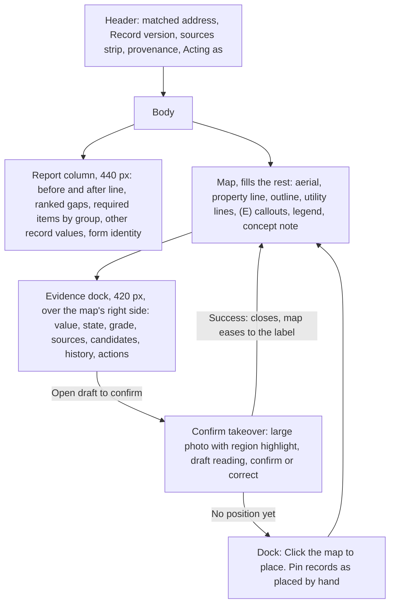
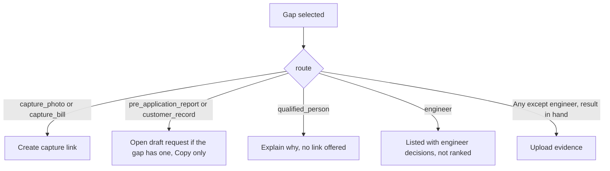
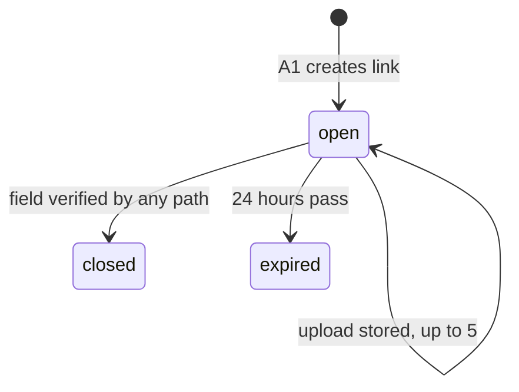
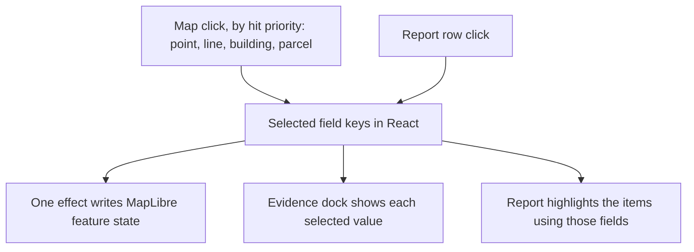

# Engineer Review and Phone Capture UI Design - Plan

## Goal Capsule

- **Objective:** A design engineer can see on one screen what is known for a site's grid connection application, why to trust each value, and what to do next, then close a gap and watch the record change. A facility contact can supply evidence from a phone without being asked to open equipment.
- **Means:** One engineer screen holding the map and the report (KTD12), actions chosen by each gap's route (KTD13), and a separately built phone page (KTD16).
- **Authority:** `CLAUDE.md` wins, then the parent plan's Product Contract, then its KTDs, then `packages/contract`, then this plan. This plan refines the parent's U7 and U9 and adds no product scope. Anything it needs outside the UI lane is listed under Requests to the Lead.
- **Numbering:** R23 onward, KTD12 onward, F3 onward, and AE6 onward continue the parent's series. Units start at U21, leaving room because the parent has reached U11. R1 to R22, U1 to U11, KTD1 to KTD11, F1, F2, and AE1 to AE5 always mean the parent's entries.
- **Stop conditions:**
  - Stop and ask if the demo would need the gap ranking changed to look better.
  - Stop and ask before pushing, deploying, or opening a public tunnel.
  - Stop and ask if a number on screen would not be measured in the run.
  - Never change `packages/contract` or add a dependency from this lane. Only the session on `main` does that (D5, D8).
- **Execution profile:** One integration into `main` from `worktree-ui`, web on port 5173. Units are ordered so a working loop exists before polish.
- **Who finishes:** The session on `main` merges in the parent's integration order and asks before pushing.

---

## Product Contract

### Summary

Design and build the engineer screen and the phone capture page. The engineer sees a marked-up site map beside an evidence check against the utility's form. Each gap offers the action its route allows: a capture link, a draft request, or a note that a qualified person is needed. Confirming evidence adds a labeled item to the map and updates the report in view.

### Problem Frame

The parent plan defines what the tool knows and how it decides, and its U7 and U9 name the main screens. They leave open what the engineer sees at each step. A flow review found that report rows have no wording, that nothing says how a phone submission reaches the engineer, and that the read-only draft flow and routes other than capture have no surface. Without these, the second flow can't be shown honestly. The UI is also the only place the non-negotiable rules are visible to the person relying on them: source evidence, separate states, labeled synthetic data, and decisions left to people.

### Actors

The parent's A1 (design engineer), A2 (facility contact), and A3 (qualified electrician or PE) apply unchanged.

### Requirements

**Screen**

- R23. Address entry, the map, the report, and evidence all fit on one engineer screen at 1440 by 900 and above, with no page navigation.
- R24. Selecting a map feature or a report row selects the same record fields on both sides and opens their evidence.
- R25. Features and rows that have no counterpart say so, and the engineer can still inspect them.

**Vocabulary**

- R26. Every value shows one of the five states from R8 as a glyph plus a word, with its fitness grade and provenance shown as separate marks.
- R27. Every report item shows its contract status in the wording under Design System. It never uses a value state's word and never uses "complete", "approved", or "ready".
- R28. A capture-trial record shows "Capture test, not a customer site" on every surface. The label comes from the record, never from anything the phone sends.

**Actions**

- R29. A gap's primary action comes from its route, following the gap routing diagram. No fixed "create link" control exists.
- R30. Every human action records a named person and the evidence they looked at, and a failed action leaves the displayed state unchanged and shows the API's reason.
- R31. A conflict offers three actions: pick a candidate with a required reason, enter another value with a file or citation, or leave it conflicting and request it from the source that can settle it. For feeder, the last is the primary action.
- R32. Confirming a reading never vouches for where the equipment is. The label shows its position's basis separately, as phone GPS or placed by hand.
- R33. A draft request is read-only with Copy as its only action, and says that the tool sends nothing.
- R34. The engineer can upload a file for a gap directly, recorded as uploaded by the engineer. A file alone becomes a draft. A value the engineer enters citing it is recorded under their name, which is how a qualified person's or utility's result enters the record.

**Pending and arrival**

- R35. While a link is open, the whole screen stays usable and the ranking doesn't move. An arrival shows as a row change, a map pin when one exists, and a non-modal notice, and never opens a panel by itself.

**Honesty on screen**

- R36. The header shows the record version and each source's outcome, and the report cites that version, the form's identity and date, and whether that form is known to be superseded.
- R37. When no requirements table applies, the map still shows, the report gives the record's stated reason and next request, and no share appears.
- R38. A snapshot record shows a permanent banner with its date and disables link creation with that reason.
- R39. Counts and timings on screen are measured in the run and labeled so, and source conflicts and feeder candidates are counted apart. The screen shows no "before" time. Parent U10 reports that, with its required label.
- R40. Owner names are masked in the demo view wherever a value appears, including conflict candidates and draft request text. The record keeps the original.

**Phone**

- R41. The capture page behaves as the Capture Page States table says, including an "I can't see this without opening anything" exit. It never shows a draft reading, and an inactive link shows no site data.
- R42. The capture build contains only the phone page and calls only the capture routes (parent KTD10).

### Key Flows

- F3. Act on a gap that isn't a capture
  - **Trigger:** A1 selects a gap routed to the utility, a customer record, or a qualified person.
  - **Steps:** The row explains the route. A utility or customer route opens the read-only draft when one exists. A qualified-person route states why and offers no link.
  - **Outcome:** A1 copies the draft and sends it themselves, or sees who must act.
  - **Covered by:** R17, R18, R29, R33
- F4. Resolve a conflict
  - **Trigger:** A1 opens a conflicting value from the report or the map.
  - **Steps:** The candidates sit side by side with their sources. A1 picks one with a reason, enters another with a citation, or leaves it conflicting and opens the request.
  - **Outcome:** The value is verified with all candidates kept, or stays conflicting with a named route.
  - **Covered by:** R10, R12, R31

### Acceptance Examples

- AE6. **Covers R29.** Given a ranked list whose first gap is a bill and whose second is a Pre-Application Report, the first row offers a capture link and the second offers the draft, and the order doesn't change.
- AE7. **Covers R27.** Given a one-line drawing row with one of two inputs filled, the row reads "Engineer decision, 1 of 2 inputs have evidence". Its input rows show their own status, each labeled team-derived.
- AE8. **Covers R32.** Given a confirmed 800 A rating from a photo with a GPS position, the map shows the (E) label, and inspecting it shows "Position: phone GPS". A hand-placed one shows "Position: placed by hand".
- AE9. **Covers R30.** Given a new observation for the field under review arriving while A1 compares a draft, Confirm is disabled and the view says new evidence arrived. Evidence arriving for other fields blocks nothing.
- AE10. **Covers R41.** Given a link whose field is already verified, the phone says it has what it needs and shows no question, aerial, or address.
- AE11. **Covers R32.** Given a capture with no usable position, including one outside the parcel, no pin appears and the rating sits under "Confirmed, not yet placed" until A1 places it.
- AE12. **Covers R37.** Given a record with no requirements table, the map renders and the report shows the stated reason with no share.

### Success Criteria

- A person who hasn't seen the tool can say, from a recording of the demo path, what is blocking the site and who must act next.
- In a browser walk, every value's source is reachable in two selections or fewer from either the map or the report.
- The parent's measured numbers that appear on screen are labeled as measured in the run.

### Scope Boundaries

**Non-goals, from the parent plan and unchanged:** submitting anything, compliance review, sizing, plan set generation, and login.

**Considered and not built**

- Image export: no requirement needs one, and it would rule out the HTML callouts in KTD15. The "exported image" clause of U7's test doesn't apply. Build it if a real export need appears.
- Map pin for an unmatched address (parent U3 and U7): a `needs_choice` response carries no base map, so there is nothing to place a pin on, and the demo parcel is chosen for one match. Candidate choice is built. Build the pin if real sites often fail to match.
- Per-source progress during a run: `runSite` returns one response, so the screen shows an elapsed timer and then each source's outcome. Build it if runs become long enough to need it.
- Cancelling a link: the contract has no route, and a link already closes on verification and expires after 24 hours.
- Stale-write rejection by record version: only one engineer writes, each confirmation cites the observation looked at, and polling disables the panel when that field changes (AE9).
- Rerouting a gap to a qualified person by hand: routes come from the server's table. Build it if EQORE wants engineers to override them.
- Retake reasons shown on the phone: a retake is another upload on the same link, up to its limit, and A1 tells the contact why.
- Compass heading: iOS needs a separate permission tap and no surface uses the value. Build it if measured placement error shows position alone isn't enough.
- Editing a draft request inside the tool: A1 edits after copying.
- Title block, sheet number, and project table on the map: these could make the map look like a construction document.
- Charts, gauges, and KPI tiles: nothing here is a trend, and the brief warns against generic dashboards.
- A full keyboard and screen-reader pass: the demo is mouse-driven with one known user. Report rows are native buttons and every state has a text word, so this is not expensive to add before real use.
- Mobile layout for the engineer screen: the role and the demo are desktop.

#### Deferred to Follow-Up Work

- QR code for the capture link, which needs a dependency added on `main`.
- An "I sent this" dated note on a draft request.
- An older-version picker. Version numbers stay visible in history regardless.
- A region highlight on PDF bills. Image evidence gets the highlight first.

### Outstanding Questions

**Deferred, not blocking**

- Which gap ranks first on the real table? This can't be known until U6's table exists, and it fixes the demo script. The design doesn't depend on the answer (AE6).
- Is a recording the deliverable? The deadline and format are unconfirmed on `main`. Design assumes a short recording, which also suits a live demo.
- Is the safety wording acceptable? `DOORS_CLOSED_SAFETY_TEXT` is a draft until an EQORE engineer reviews it (parent U9). The review should also cover locked rooms and fenced areas, which it doesn't mention.

### Sources

- `docs/plans/2026-11-07-0954-feat-site-data-collection-plan.md`: parent requirements, flows, and units.
- `packages/contract/src/schemas.ts` and `packages/contract/src/routes.ts`: the shapes and routes this design uses. `packages/contract/samples/` holds the sample payloads.
- `docs/research/2026-11-07-option1-sample-plan-sets.md`: what a finished site map contains. Sample 1 G-100 was not viewed as an image in this planning pass, so that document is the source for its layout.
- `docs/research/2026-11-07-option1-plan-set-bridge.md`: the drawing vocabulary for uncertain values.
- `docs/research/2026-11-07-option1-capture-tools.md`: the doors-closed rule and limits on extraction.
- MapLibre: [installation](https://maplibre.org/maplibre-gl-js/docs/#installation), [style layers](https://maplibre.org/maplibre-style-spec/layers/).
- Phone: [Geolocation API](https://developer.mozilla.org/en-US/docs/Web/API/Geolocation_API/Using_the_Geolocation_API), [WebKit EXIF bug 257534](https://bugs.webkit.org/show_bug.cgi?id=257534) (search excerpt only).
- Tunnels: [Cloudflare quick tunnels](https://developers.cloudflare.com/cloudflare-one/networks/connectors/cloudflare-tunnel/do-more-with-tunnels/trycloudflare/), [ngrok free plan limits](https://ngrok.com/docs/pricing-limits/free-plan-limits/) (search excerpt only).

---

## Planning Contract

### Key Technical Decisions

- KTD12. **One screen with a dock and a takeover.** The report is a fixed left column, the map fills the rest, and evidence docks over the map's right side. Separate map and report pages were rejected because the gap, its fix, and the state change need to stay in view together. Reading digits needs a large photo, so the confirm view alone takes over the screen, and it closes on success so the new label is seen.
- KTD13. **Actions come from the route and one small table.** The UI never computes a state. A pure table in `apps/web/src/app/actions.ts` lists which actions each value state offers, following the parent's state diagram, and the server still rejects anything illegal with `illegal_transition`. This stops the UI inventing a path to `verified`.
- KTD14. **Use MapLibre directly from a React effect, not `react-map-gl`.** The map is mostly static layers plus external selection, and `maplibre-gl` is the only map dependency on `main`. MapLibre v6 is ESM-only and needs its worker URL set explicitly for Vite.
- KTD15. **(E) callouts are HTML markers.** They are never culled by label collision, take CSS leader lines, and need no glyph files, which keeps the offline demo simple. The cost is that a canvas export wouldn't include them, and no export is built.
- KTD16. **The phone page builds separately.** Parent KTD10 and U8 put it on the capture listener. A second Vite config builds only `capture.html` to `apps/web/dist-capture/`, because a multi-entry build would write engineer chunks into the folder that listener serves. The engineer app reaches its API through Vite's proxy.
- KTD17. **Poll `readVersion` for `latest` every 3 seconds while a link is open.** A capture creates a new version with trigger `capture`, so no separate status route is needed. The engineer app is local, so polling is the least code and fails softly. No poll runs when no link is open.
- KTD18. **Selection is a set of field keys.** A map feature has one `field`, and a report item has `fields`, so React holds the selected set and one effect writes MapLibre feature state. Feature state is lost on `setData`, so that effect also reapplies it.
- KTD19. **A panel watches its own field.** New versions update the screen as they arrive. If the field under review gains an observation, the panel keeps what the engineer was reading, disables its actions, and offers a reload.
- KTD20. **Position travels as form fields, never EXIF.** iOS reports show GPS removed from camera captures in file inputs, and Android wasn't verified. Photo prompts use a file input with `capture`, which has fewer failure modes than `getUserMedia`. Bill prompts use a plain file input, since `capture` would open the camera and block a PDF.
- KTD21. **Default to a Cloudflare quick tunnel.** ngrok's free plan puts a warning page in front of browser traffic, which would break a phone link on camera. Cloudflare's docs mention no such page, though that isn't proof, so one real-phone test is required. Its hostname changes on each run, so the link comes from the server at runtime.
- KTD22. **Plain React state and system fonts.** The app has one screen, one record, and a few panels. A reducer and a polling hook hold it, and CSS custom properties carry the tokens. System fonts need no dependency and work offline.

### Design System

**Direction: a marked-up drawing, not a dashboard.** Engineers already read plan sets, so the screen borrows their marks: a faded aerial, a dashed property line, leader-line callouts marked (E), and `~` for uncertain values. There are no tiles or charts. Counts are sentences. Values use a monospace face so digits are easy to compare with a photo.

**Value states (R26).** Each has a glyph and a word, so color is never the only signal.

| State | Word on screen | Glyph | Color |
|---|---|---|---|
| missing | Missing | Dashed empty circle | `#5F6468` |
| conflicting | Conflicting, with its kind: "Sources disagree" or "Feeder candidates" | Two offset circles | `#B3261E` |
| unreadable | Unreadable | Circle with a slash | `#8A5A00` |
| inferred | `~` Inferred, plus its method: "Read from source", "Assumed", "Computed", or "Draft from photo" | Tilde | `#1F5FA8` |
| verified | Verified, plus the person's name | Filled circle with a check | `#1E7A46` |

**Item statuses (R27).** These map the contract's four statuses to words.

| Contract status | Word on screen | Added detail |
|---|---|---|
| `has_evidence` | Evidence in hand | |
| `needs_evidence` | Needs evidence from [owner] | ", N conflicting" when any of its fields conflict. "Waiting on [owner]" once a link is open |
| `preview_only` | Preview only | "Public data, not the authoritative source" |
| `engineer_owned` | Engineer decision | "N of M inputs have evidence" when the row has inputs |

Input rows carry a "Team-derived" tag. Gaps routed to `engineer` sit with the engineer decisions, outside the ranked list, reading "Your decision. This tool does not fill it."

**Link status on a gap row.** The row reads the link plus the field's latest observation:

| Situation | Row text | Action |
|---|---|---|
| Link open, nothing new | "Link created 10:42, waiting for a photo", with the real time | Copy link again |
| New `reading` by `model_draft` | "Draft ready to confirm" | Open confirm view |
| New `unreadable` | "Couldn't read it" | Open confirm view, to read it or send the link again |
| New `failed_extraction` | "Reading failed: [reason]" | Send the link again, or upload the file |
| Link `expired` | "Link expired" | Create a new link |
| Link `closed` | Row returns to its evidence status | |

**Other marks.**

- **Fitness grade:** a small text tag of Reference, Layout, or Nameplate (R9).
- **Provenance:** a text tag of "Real public data" or "Synthetic" (R22).
- **Route:** Public data, Utility, Customer, Engineer, or Qualified person (R16).

**Type and color.** A system sans stack for interface text and a system monospace stack for values. Body text is at least 14 px, and key values are at least 16 px so they survive video compression. The paper background is `#F7F6F2`, ink is `#1C2326`, and rules are `#D8D6CE`. Selection is `#F05A00`, used only for selection.

**Map marks.**

- **Aerial:** faded toward the paper color, as in Sample 1 G-100.
- **Property line:** long-dash line with a light casing, using the feature's label.
- **Building outline:** thin solid ink line.
- **Utility lines:** a single violet line labeled "Utility-published, for this location".
- **Existing equipment:** a white plate on a leader line, reading "(E) 800 A main switchboard".
- **`capture_pin` feature:** a hollow pin reading "Photo, unconfirmed", with no (E).
- **Always visible:** a scale bar in feet, a north arrow, a legend, the concept note, and attribution. Rotation and pitch are disabled.

**Concept note (R15).** "Concept-grade. Based on public data. Not surveyed. Not a construction document." Once a customer photo has placed a label, it reads "Based on public data and customer photos". It sits where the dock can't cover it.

**Report subtitle.** "Evidence check against the form. Not an approval or a prediction of utility review."

**Panel behavior.** One panel shows in the dock at a time. Evidence, conflict controls, the link dialog, and the draft drawer all render there, and closing returns to the value view. Selecting something else while a form has unsaved input asks "Discard changes?" inline. Esc closes the top panel. The takeover returns focus to the row it came from.

**Motion.** The only motion is the map easing to a new label and a brief row highlight after a state change. Both respect reduced-motion settings.

### High-Level Technical Design

Engineer screen regions:



Gap routing (R29), using the contract's `route` values:



When a gap has no `draftRequest`, including when the parent cuts R18 first, the row names the request and reads "No draft available".

Capture link, as the contract and parent U8 define it:



The upload's outcome reaches the engineer as a new record version, and the row text comes from that version's observations. A retake is another upload on the same link.

Selection (KTD18):



### Demo Path

This is the path the design is checked against. Gap order and all counts come from the real run, and the script is fixed once U6's table exists. Venue photos never go on the Worcester record (parent U9).

| Beat | Record | Engineer sees | Point it proves |
|---|---|---|---|
| Enter address | Worcester | Elapsed timer, then the map and report with a version and each source's outcome | Public data fills the physical and utility side, labeled as real |
| Read the report | Worcester | Ranked gaps with owners, conflict and feeder candidate counts apart, and engineer decisions kept apart | What is missing and who must supply it |
| Inspect a conflict | Worcester, or AE1's labeled Holliston fixture if the parcel has none | Candidates side by side with sources | Sources kept, nothing chosen silently |
| Open the top gap | Worcester | The action its route allows, shown as ranked (AE6) | A deterministic ranking that isn't tuned for the demo |
| Close a capture gap | Worcester | Labeled synthetic evidence uploaded by the engineer, then the draft beside the photo, confirm or correct | A person decides, and the draft is kept |
| State change | Worcester | The takeover closes, the (E) label appears, and the before and after line updates with the new version | The closed loop, measured in the run |
| Live phone | Capture trial, labeled | Link created, phone shows safety text, photo sent, row changes, pin appears | A contact can help without opening equipment |

### Surface States

| Surface | Loading | Empty | Partial source failure | Snapshot | Field changed under review | Error |
|---|---|---|---|---|---|---|
| Header | "Running sources" with elapsed timer | Address field | "5 of 6 sources answered", each with its reason | Permanent banner with date | "Newer version" with Load | `needs_choice`: candidate list. No candidates: "No match found. Nothing stored." |
| Map | Skeleton | No site: no base, no note. No equipment yet: "No existing equipment placed yet. Public data doesn't show it." | Missing layers named with reasons | Saved imagery, "Recorded" on its source | Updates as versions arrive | Tiles failed or no `baseMap`: vectors stay, "Aerial unavailable" |
| Report | Rows appear with the record | No table: R37 | Affected rows show missing with the reason, distinct from "none" (R11) | Labeled | Updates as versions arrive | Keeps last version, "Last updated" |
| Evidence dock | Inline | "No value yet", its route, and the query recorded | Reason per source, from the `no_value` observation | Source links marked "may need network" | New-evidence notice, actions disabled | Action failed: state unchanged, API message shown |
| Confirm takeover | Confirm disabled until the file loads | Not reachable without evidence | Not applicable | Label for a recorded draft | New-evidence notice, reload needed | File failed to load: no confirm allowed |

### Action Fields

Every action that changes a value sends the actor's name and evidence. Every action appends (R10). A reason or citation is sent as a `document` evidence reference, because the contract has no separate reason field.

| Action | From state | Route | Also required | Result |
|---|---|---|---|---|
| Confirm a draft or source value | inferred | `confirmValue` | The observation looked at | verified |
| Correct a draft | inferred | `correctValue` | Value, the draft's observation | verified at the new value, draft kept (AE3) |
| Read an unreadable file | unreadable | `correctValue` | Value, the file's observation | verified |
| Pick a candidate | conflicting | `resolveConflict` | Candidate ID, its observation, reason | verified, candidates kept |
| Enter another value | conflicting | `correctValue` | Value, file observation or citation | verified |
| Leave conflicting and request | conflicting | None, opens the gap's draft | None | no state change |
| Record a person's result | missing | `correctValue` | Value, file observation or citation | verified |
| Upload evidence | missing, unreadable, inferred | `uploadEvidence` | File | draft, unreadable, or failed reading |
| Place or move equipment | any | `movePin` | Field, coordinates, name | method `hand_placed` |
| Create link | gap with `captureLinkAllowed` | `createCaptureLink` | Field | link `open`, no value change |

Plausibility flags only warn. They never enable or disable Confirm (parent Risks).

### Capture Page States

| State | Phone shows | Stores |
|---|---|---|
| Loading | "Loading this request" | Nothing |
| Network failure on load | "Couldn't reach this request. Try again." | Nothing |
| Open | Question, one-pin aerial if supplied, safety text, then the location step | Nothing yet |
| Location step | "Share your location once, to place this photo on the site map." Share and Skip buttons | Nothing yet |
| Location denied or slow, about 10 s | "That's fine. You can still send the photo." | No position, so A1 places the pin |
| Capture | Camera for a photo prompt, file picker for a bill, and "I can't see this without opening anything" | Nothing yet |
| Preview | Photo with Use or Retake | Nothing yet |
| Uploading | Progress, "Keep this page open. This can take a moment." | Nothing yet |
| Upload failed | "Not sent. Try again." File stays on the page | Nothing |
| `file_type` or `file_too_large` | The plain limit and how to fix it | Nothing |
| Received | "Received. Nothing is verified yet. An engineer will review it." | File, hash, position, accuracy |
| Can't see it | "Thanks. Please don't open anything. Tell the person who sent you this link." | See Requests to the Lead |
| `invalid_token` or `token_expired` | "This link isn't active. Please ask the person who sent it." | Nothing |
| `token_closed` | "We have what we need. Thank you." | Nothing |
| `upload_limit` | "This link has reached its upload limit. Please ask the person who sent it." | Nothing |

The safety text is the contract's `safetyText`, sits above the capture control, can't be dismissed, and appears on every prompt, including bills. The footer reads "Prototype. Safety wording not yet reviewed." The phone never sees `state` wording from the result, so it never reveals a reading.

### Requests to the Lead

None of these blocks the UI lane from starting. Each states what the UI does until it is answered.

**Needed before the walk (U28)**

1. A record-level capture-test label on `SiteSchema`, so R28 can be server-set. Until then the capture-trial record can't be told apart, so the live phone beat waits on this.
2. How `/capture/:token` serves both the page and the JSON request, since a phone opening `link.url` needs HTML and `readCaptureRequest` shares that path. The UI assumes the page is served by default and fetches with `Accept: application/json`.
3. The capture listener serves `apps/web/dist-capture/`, built by a `build:capture` script.

**Wanted, with a fallback**

- A `not-visible` capture route that records a `no_value` observation. Until then the phone's exit is client-only, which still keeps the contact from opening anything, and the engineer isn't told.
- A retry route for `failed_extraction` (parent KTD8). Until then the row offers sending the link again or uploading the file.
- A list route for a site's capture links. Until then the link lives in browser state, and a reload loses the waiting text.
- A tag on owner-name values. Until then the demo mask matches field keys containing `owner`, which U28 checks against the seeded record.
- Named flags or a field on the value for `needs_pin` and `outside_parcel`, which `CaptureResult` returns only to the uploader. Until then both read as "Confirmed, not yet placed" (AE11), with no reason.

**To settle in the parent plan**

- If an engineer verifies a feeder candidate, does the row needing the Pre-Application Report stay `preview_only`? The status comes from the server, so the UI shows whatever it returns, and one click could otherwise clear that row.

**For the backend lane**

- `submitCapture` takes only the file and `CaptureMetadataSchema` and ignores anything else, so a token holder can never set a value, an actor, or a state.
- Intake allows only JPEG, PNG, and PDF, checked by file signature. Evidence is stored by hash and served with its checked type and `X-Content-Type-Options: nosniff`, because a public upload is later opened on the no-login engineer origin.
- Extraction runs inside `submitCapture`, since `CaptureResult` returns its state, so the phone waits on a model call. Set a timeout that returns `extraction_failed` rather than leaving the phone hanging.

### Risks

| Risk | Mitigation |
|---|---|
| The real ranking doesn't put a capture first | R29 and AE6 hold on any order, and the script closes the highest-ranked capture gap and says so |
| The contract's samples are single versions, so nothing exercises a state change | U21's mock API derives a labeled sequence locally from them, and U28 replaces it with the real API |
| A phone's location prompt and camera can't share one tap | The location step comes first with its own buttons, so a slow fix can't lose the camera's user activation. The real-phone test confirms this |
| HEIC upload from an iPhone can't be shown in a desktop browser | Only JPEG, PNG, and PDF are accepted, and one iPhone is tested early. Camera capture usually returns JPEG, which is unverified here |
| Tunnel or phone fails on stage | R34 uploads evidence from the engineer screen (parent KTD9) |
| The map hides behind the dock on a 1440 screen | The map's padding shifts its center so the selected feature stays visible |
| Demo re-records start from an altered record | The parent's seed command rebuilds the database, so no UI is needed |

### Output Structure

```text
apps/web/
  index.html            engineer entry
  capture.html          phone entry
  vite.config.ts        engineer build, API proxy
  vite.capture.config.ts  phone build, to dist-capture/
  src/
    App.tsx, api.ts, mockApi.ts
    app/                record polling, selection, actions table, Acting as, demo mask
    header/             site header, sources strip, snapshot banner
    map/                SiteMap, layers, callouts
    panels/             report, evidence, resolve, draft, link, upload, confirm
    capture/            phone page
    ui/                 tokens and shared marks
```

---

## Implementation Units

### U21. App shell, tokens, and mock API

- **Goal:** Stand up `apps/web` with the design tokens, shared marks, header, and a mock API that walks a labeled sequence of states.
- **Requirements:** R22, R23, R26, R28, R36, R38
- **Dependencies:** Parent U1, which is committed
- **Files:** `apps/web/package.json` (scripts only), `apps/web/vite.config.ts`, `apps/web/index.html`, `apps/web/src/main.tsx`, `apps/web/src/App.tsx`, `apps/web/src/api.ts`, `apps/web/src/mockApi.ts`, `apps/web/src/mockApi.test.ts`, `apps/web/src/ui/tokens.css`, `apps/web/src/ui/marks.tsx`, `apps/web/src/ui/marks.test.tsx`, `apps/web/src/header/SiteHeader.tsx`, `apps/web/src/header/SiteHeader.test.tsx`, `apps/web/src/app/useRecord.ts`, `apps/web/src/app/useRecord.test.ts`, `apps/web/src/app/actor.ts`
- **Approach:**
  1. Use a reducer holding record, report, link, and selection, with a polling hook per KTD17.
  2. Type the API client and the mock from `routes`, so integration replaces only the implementation.
  3. Derive the sequence from the committed samples: link open, draft ready, verified, corrected, unreadable, failed reading. Mark every step synthetic and validate each against the schemas.
  4. Ask for the "Acting as" name at the first action and mark it "self-entered, no login in this prototype". Wrap browser storage in try/catch.
- **Test scenarios:**
  - Each of the five states renders its own glyph and word.
  - An inferred value shows its method text, and a verified value shows its person's name.
  - A synthetic record shows the Synthetic tag, and a real source shows "Real public data".
  - A snapshot record shows the banner with its date.
  - "5 of 6 sources answered" expands to each source's reason.
  - `needs_choice` lists candidates, and choosing one sends `candidateId`.
  - An empty candidate list reads "No match found. Nothing stored."
  - Polling runs while a link is open and stops when it closes or expires.
  - Blocked browser storage still lets a name be entered for the session.
  - Every step of the mock sequence passes `RecordVersionSchema`.
- **Verification:** The shell renders the sample record with no network. Text tokens meet 4.5:1 on the paper background, the selection mark meets 3:1, and rule lines are exempt.

### U22. Readiness report

- **Goal:** Show ranked gaps, required items, and other record values, with route-driven actions.
- **Requirements:** F1, R16, R17, R19, R25, R27, R29, R37, R39
- **Dependencies:** U21
- **Files:** `apps/web/src/panels/ReadinessPanel.tsx`, `apps/web/src/panels/ReadinessPanel.test.tsx`
- **Approach:**
  1. Order the column as before and after line, ranked gaps, required items by status group, then "Other record values, not required by this form" with conflicts first.
  2. Render the server's ranking without reordering it.
  3. Show form rows and input rows counted separately from `share`, and nest input rows under `parentItemId`.
  4. Cite version, form, and date in a footer, adding "based on a superseded form" when `superseded` is true.
- **Test scenarios:**
  - Covers AE6. The sample's bill gap offers a link and its Pre-Application gap offers a draft, in server order.
  - Covers AE7. The sample's one-line row reads "Engineer decision, 1 of 2 inputs have evidence", and its input rows carry the team-derived tag.
  - Covers AE12. No table shows the stated reason, with no share and no form footer.
  - Covers AE4. The sample's bus rating gap explains why and offers no link.
  - The sample's engineer-route gap appears with engineer decisions and not in the ranked list.
  - A gap with no `draftRequest` on a draft route reads "No draft available".
  - Source conflicts and feeder candidates are counted apart using `conflictKind`.
  - Lot size conflict appears under other record values.
  - No row text contains "complete", "approved", or "ready".
- **Verification:** The report for the sample record can be checked by hand against the sample payload, and its order matches.

### U23. Site map

- **Goal:** Render the record as a marked-up map that stays in sync with selection.
- **Requirements:** F1, R14, R15, R24, R25, R32
- **Dependencies:** U21
- **Files:** `apps/web/src/map/SiteMap.tsx`, `apps/web/src/map/SiteMap.test.tsx`, `apps/web/src/map/layers.ts`, `apps/web/src/map/layers.test.ts`, `apps/web/src/map/callouts.tsx`, `apps/web/src/map/callouts.test.ts`, `apps/web/src/app/selection.ts`, `apps/web/src/app/selection.test.ts`
- **Approach:**
  1. Follow KTD14 for setup and teardown, and create the map once under StrictMode.
  2. Take the base from `baseMap`, with no hard-coded region. MapLibre fails tiles silently, so listen for source errors and show "Aerial unavailable".
  3. Keep layer definitions as pure data, and use one effect per KTD18.
  4. Place callouts outward from the parcel center, so labels fan out deterministically.
  5. Offer a "click to place" mode for `movePin`.
- **Test scenarios:** MapLibre needs WebGL, so tests mock it and check calls and data. They catch wiring and miss rendering, which the browser walk covers.
  - The map is created once and removed on unmount.
  - Selecting a row sets feature state on its features and clears the previous selection.
  - Replacing source data reapplies the selection.
  - Hit priority picks a point over the parcel beneath it.
  - An `existing_equipment` feature gets an (E) callout.
  - A `capture_pin` feature gets a hollow pin with no (E).
  - Covers AE8. A confirmed rating shows its label, and `placedByHand` decides the position text.
  - Covers AE11. A confirmed rating with no feature appears in "Confirmed, not yet placed".
  - A null `baseMap` leaves the vectors and shows "Aerial unavailable".
  - The concept note changes wording once a customer photo places a label.
  - Placing a pin sends the field, coordinates, and name, and a failure leaves the map unchanged.
- **Verification:** In a browser with the sample record, the imagery, lines, and labels all show, and the note and legend stay visible with the dock open.

### U24. Evidence dock and conflict resolution

- **Goal:** Show every value's source and history, and let the engineer act on it.
- **Requirements:** F1, F4, R7, R10, R12, R24, R26, R30, R31, R34, R40
- **Dependencies:** U22, U23
- **Files:** `apps/web/src/panels/EvidencePanel.tsx`, `apps/web/src/panels/EvidencePanel.test.tsx`, `apps/web/src/panels/ResolveControls.tsx`, `apps/web/src/panels/ResolveControls.test.tsx`, `apps/web/src/panels/UploadEvidence.tsx`, `apps/web/src/panels/UploadEvidence.test.tsx`, `apps/web/src/app/actions.ts`, `apps/web/src/app/actions.test.ts`, `apps/web/src/app/demoMask.ts`, `apps/web/src/app/demoMask.test.ts`
- **Approach:**
  1. Build the actions table and evidence references per KTD13 and Action Fields.
  2. Follow KTD19 while a panel is open.
  3. Apply the demo mask before any value renders.
- **Test scenarios:**
  - A value shows source, retrieval date, source date, method, location in source, grade, and provenance.
  - Covers AE1. Lot size shows both candidates with their sources.
  - Covers AE2. Feeder shows both candidates with their attributes, and "Leave conflicting and request" is the primary action.
  - Picking a candidate without a reason is blocked, and the reason is sent as a document reference.
  - Entering another value without a file or citation is blocked.
  - An API rejection such as `verifier_required` shows its message and leaves the state as it was.
  - Covers AE9. A new observation on the open field disables actions, and one on another field doesn't.
  - History lists the original and every later observation after a correction.
  - `none` and `missing` read differently.
  - The actions table offers nothing for a verified value and matches the Action Fields table.
  - An uploaded file returning `inferred` is offered for confirmation, and one returning `extraction_failed` shows the reason.
  - A value entered citing an uploaded file sends that file's observation as evidence.
  - A seeded owner name appears nowhere in the rendered dock, conflict controls, or draft text in demo mode.
- **Verification:** From the sample record, a person can walk F4 to both of its outcomes.

### U25. Gap actions: capture link and draft request

- **Goal:** Make each route's action work and show the waiting state honestly.
- **Requirements:** F2, F3, R18, R29, R33, R35, R38, R40
- **Dependencies:** U22
- **Files:** `apps/web/src/panels/CaptureLinkDialog.tsx`, `apps/web/src/panels/CaptureLinkDialog.test.tsx`, `apps/web/src/panels/DraftRequestDrawer.tsx`, `apps/web/src/panels/DraftRequestDrawer.test.tsx`
- **Approach:**
  1. The link dialog shows the link and Copy, and says "This tool does not send it".
  2. The draft drawer is titled "Draft. This tool does not send anything."
  3. Row text follows the link status table, and arrival follows R35. If the parent cuts R18, the drawer is simply never reached, and the list of what was cut names it.
- **Test scenarios:**
  - No draft view contains a send control or a `mailto:` link.
  - Copy places the text on the clipboard, and a blocked clipboard shows selectable text.
  - Creating a link changes no value state and doesn't reorder the ranking.
  - The row reads "Link created 10:42, waiting for a photo" using the real time.
  - A new version with a draft on that field changes the row and shows a notice without opening a panel.
  - `unreadable` and `failed_extraction` observations each show their row text.
  - An expired link offers a new link.
  - A snapshot record disables link creation and states why.
- **Verification:** From the mock sequence, a person can walk F3 and reach the waiting state of F2.

### U26. Confirm takeover and placement

- **Goal:** Let the engineer compare a draft with its evidence, then confirm or correct it, and place it if needed.
- **Requirements:** F2, R8, R10, R14, R20, R25, R30, R32
- **Dependencies:** U23, U24
- **Files:** `apps/web/src/panels/ConfirmPanel.tsx`, `apps/web/src/panels/ConfirmPanel.test.tsx`
- **Approach:**
  1. Load the file through `readEvidenceFile`. Show an image large with `imageRegion` highlighted and a click to zoom, or a PDF in the browser's own viewer, beside the draft value and its provenance.
  2. On success, close the takeover, ease the map to the label, and update the before and after line.
  3. With no position, the dock says "Click the map to place" using U23's mode.
- **Test scenarios:**
  - Confirm is disabled until the file has loaded.
  - A PDF renders in a viewer and enables Confirm once loaded.
  - Covers AE3. Correcting 800 A to 600 A shows 600 A verified under A1's name and keeps the draft in history.
  - Confirming a draft updates the report and ranking from the returned version.
  - Confirming a reading doesn't change the position text.
  - Moving a pin records it as placed by hand.
  - Covers AE9. New evidence on the field during review disables Confirm and asks for a reload.
  - A file that fails to load allows no confirm.
  - An unreadable file offers a person's reading.
  - Covers AE5. Instruction text inside a draft displays as content and changes nothing.
  - A failed confirm leaves the state unchanged and shows the API's message.
- **Verification:** From the mock sequence, a person can walk from draft ready to the new label, and the takeover closes on success.

### U27. Phone capture page

- **Goal:** Let a facility contact send a photo or bill from a phone browser safely.
- **Requirements:** F2, R5, R6, R22, R41, R42
- **Dependencies:** U21, and parent U8 for the real-phone check
- **Files:** `apps/web/capture.html`, `apps/web/vite.capture.config.ts`, `apps/web/src/capture/main.tsx`, `apps/web/src/capture/CapturePage.tsx`, `apps/web/src/capture/CapturePage.test.tsx`
- **Approach:**
  1. Build per KTD16, importing nothing from the engineer panels and no MapLibre. Show `aerial` as a small tile grid from its template, center, and zoom, with a CSS pin.
  2. Use one screen per request with tap targets of at least 48 px.
  3. Choose the file input by `accepts` (KTD20), and send position as form fields.
  4. Send the original file with no client compression, since the server hashes it.
- **Execution note:** Test on one real iPhone and one Android over the tunnel before polishing. The geolocation prompt and file types only show up there.
- **Test scenarios:**
  - The contract's safety text appears above the capture control on photo and bill prompts, and can't be dismissed.
  - A photo prompt's input uses `capture`, and a bill prompt's accepts JPEG, PNG, and PDF with no `capture`.
  - Denied location still allows sending, and shows the plain message.
  - Slow location gives up after about 10 seconds and still allows sending.
  - A failed upload keeps the file and offers another try.
  - `file_type` and `file_too_large` show the limit and send nothing.
  - "I can't see this" ends the flow with no photo.
  - Covers AE10. `token_closed` shows no question, aerial, or address.
  - `invalid_token` and `token_expired` show the same inactive message, and `upload_limit` shows its own.
  - A network failure on load offers another try rather than an inactive message.
  - Received shows that nothing is verified yet, and no state of the page shows a draft reading.
  - The capture build output contains no engineer panel code.
- **Verification:** On a real phone over the tunnel, a teammate sends a doors-closed photo on the capture-trial record from parent U10, and it reaches the engineer screen with the R28 label.

### U28. Integration and demo walk

- **Goal:** Replace the mock with the real API and prove the demo path end to end.
- **Requirements:** F1, F2, F3, F4, R3, R13, R36, R38, R39, R40, Success Criteria
- **Dependencies:** U22 through U27, parent U5, U6, and U8, and parent U10's seed and snapshot steps. Those steps land before this unit, and parent U10's own verification runs after it.
- **Files:** `apps/web/src/api.ts`, `apps/web/src/api.test.ts`, `docs/plans/2026-11-07-1015-feat-engineer-review-ui-design-plan.md`
- **Approach:**
  1. Run the real ranking and fix the Demo Path against it, without changing the ranking.
  2. Walk the path live and with the network off.
  3. Run one Fremont record to confirm no region-specific code exists in the UI. Its parcel and outline stay missing with a person route, and imagery depends on parent U11.
- **Execution note:** This is integration, so prefer a full runtime walk over new unit tests. Use `ce-test-browser` or the `run` skill.
- **Test scenarios:**
  - An API error for any action surfaces in the UI and changes no state.
  - A Fremont record with no parcel renders its gaps. It shows PG&E's form identity, or the no-table reason if the parent cut that table.
  - The real seeded owner name appears nowhere in the rendered Worcester demo view.
- **Verification:** Every beat of the Demo Path runs at 1920 by 1080 with no console errors, and every number on screen came from that run.

---

## Verification Contract

| Check | Command or action | Expected result |
|---|---|---|
| Unit and component tests | `npm test` | All pass with no network calls |
| Types | `npm run typecheck` | No errors, and the web app imports the contract rather than redefining its types |
| Contract version | After `git merge main`, compare `CONTRACT_VERSION` with the backend worktree | Same in both |
| No lane changes to shared files | Review the diff | No change under `packages/contract`, and no new dependency in `apps/web/package.json` |
| LLM boundary | Code review of `apps/web/src/panels/ConfirmPanel.tsx` | No path sets `verified` without a named person's action |
| Send boundary | Search the web app for `mailto:` and send controls | None |
| Capture boundary | The parent's check, with the tunnel up | Engineer routes return 404 through the tunnel |
| Token write boundary | Submit through a token with extra value and name fields | No value changes state, and the extra fields aren't stored |
| Capture build | Inspect `apps/web/dist-capture/` | No engineer panel code |
| Demo walk | Run `npm run demo:seed`, then walk the Demo Path in a browser | Each beat works, evidence is inspectable, and the state change shows |
| Fallback | With the network off, walk F1 and F2 on Worcester | Snapshot banner shows, and the upload is recorded as made by the engineer |
| Real phone | One iPhone and one Android on the capture-trial record, after the team approves opening the tunnel | Photo arrives, and denied location still sends |

---

## Definition of Done

- All requirements here and parent R5, R6, R14 to R20, and R22 are met or listed as not built, with the reason.
- Every check in the Verification Contract passes.
- If time runs short, keep the item statuses, conflict controls, confirm takeover, polling, snapshot banner, capture page states, and safety text. Cut the Deferred items first, and follow the parent's cut order for anything shared.
- No number, time saving, or approval claim appears unless it was measured in the run.
- Synthetic evidence and the capture-trial record are labeled on every surface they reach.
- Abandoned-attempt code is removed from the diff.
- Secrets, local databases, and uploads are not in Git.
